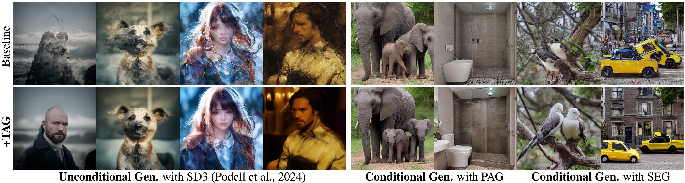

<div align="center">

# TAG: Tangential Amplifying Guidance for Hallucination-Resistant Sampling

[Hyunmin Cho](https://github.com/hyeon-cho/)\*, [Donghoon Ahn](https://sunovivid.github.io/)\*, [Susung Hong](https://susunghong.github.io/)\*, [Jee Eun Kim](https://github.com/jeeeun-k), [Seungryong Kim](https://cvlab.kaist.ac.kr/members/faculty)&dagger;, [Kyong Hwan Jin](https://ipa.korea.ac.kr/)&dagger;

<sub>\* equal contribution &nbsp;·&nbsp; &dagger; corresponding authors</sub>

**ICML 2026 Regular**

[](https://arxiv.org/abs/2510.04533)
[](https://hyeon-cho.github.io/TAG/)
[](https://openreview.net/forum?id=1XJqPy2LhA)

</div>

---

Diffusion models hallucinate: samples drift into off-manifold states that surface as
duplicated limbs, broken objects, or incoherent layouts. **Tangential Amplifying Guidance
(TAG)** counters this directly on the *sampling trajectory*: at each step, the sampler update
is decomposed around the radial direction of the current latent into a **radial** component
and a **tangential** component, and the tangential part — which carries the semantic
correction — is selectively amplified. This steers samples back toward high-probability
regions without touching the model, the attention, or requiring any training.

<div align="center">

</div>

## Highlights

- 🧭 **Trajectory-level control**: amplifies the tangential component of the sampler update — no architecture changes, no retraining, negligible overhead.
- 🔌 **Drop-in pipelines** for SD 1.5, SD 2.1, SDXL, and SD 3 — standard `diffusers` pipelines with two extra scalars (`t_guidance_scale`, `r_guidance_scale`).
- 🎯 **Hallucination-resistant sampling**: suppresses off-manifold drift while keeping prompts and seeds fixed.
- 🧪 **Conditional TAG**: a CFG-aware variant that amplifies the aligned tangential component of the guidance signal in score space (see the demo notebook).

## News

- **[2026.04.30]** 🎉 TAG is accepted to **ICML 2026 Regular**.
- **[2025.10.06]** 📄 Preprint released on [arXiv](https://arxiv.org/abs/2510.04533).

## Installation

Python 3.10 recommended.

```bash
# 1) torch matching your CUDA (example: cu121)
pip install torch --index-url https://download.pytorch.org/whl/cu121
# 2) the rest
pip install -r requirements.txt
```

Model weights (SD 1.5 / 2.1 / XL / 3) are downloaded automatically from the Hugging Face Hub
on first use. SD 3 requires accepting its license on the Hub beforehand.

## Quickstart

```bash
# baseline generation (TAG disabled: t_lr = r_lr = 1.0)
python run.py --config-name sdxl generation.prompt="a photo of a corgi"

# with TAG: amplify the tangential component (example operating point)
python run.py --config-name sdxl generation.prompt="a photo of a corgi" \
    generation.t_lr=1.2 generation.cfg_scale=5.0
```

`--config-name` selects the model (`sd1`, `sd2`, `sd3`, `sdxl` — see `conf/`). Key fields, all
overridable from the command line:

| field | meaning |
|---|---|
| `generation.t_lr` | tangential scale (`t_guidance_scale`); `1.0` disables TAG |
| `generation.r_lr` | radial scale (`r_guidance_scale`) |
| `generation.cfg_scale` | classifier-free guidance weight |
| `generation.seed`, `generation.n_steps` | seed / number of sampling steps |
| `pipeline.scheduler` | `ddim`, `pndm`, `dpm_solver`, `euler` (default: model's own) |

Outputs are saved under `with_TAG/` (TAG enabled) or `without_TAG/` (baseline), with the
configuration encoded in the filename. See the paper / project page for recommended
operating points per model.

## Use it in your own pipeline

The TAG pipelines are standard `diffusers` pipelines with two extra call arguments:

```python
import torch
from pipelines.pipeline_tag_stablediffusionXL import StableDiffusionXLTangentialDecomposedPipeline

pipe = StableDiffusionXLTangentialDecomposedPipeline.from_pretrained(
    "stabilityai/stable-diffusion-xl-base-1.0", torch_dtype=torch.float16
).to("cuda")

image = pipe(
    "a photo of a corgi",
    guidance_scale=5.0,
    t_guidance_scale=1.2,   # amplify the tangential component (1.0 = vanilla)
    r_guidance_scale=1.0,   # radial component scale
    # sta_tpd=1000, end_tpd=0,   # timestep window in which TAG is applied
).images[0]
image.save("tag.png")
```

The same interface is exposed by `StableDiffusionTangentialDecomposedPipeline` (SD 1.5/2.1)
and `StableDiffusion3TangentialDecomposedPipeline` (SD 3).

## Conditional TAG (CFG-aware variant)

`pipelines/pipeline_ctag_stablediffusionXL.py` implements Conditional TAG, which operates in
score space: the guidance direction is decomposed around the radial axis of the current
latent, and the component of the conditional score aligned with the tangential guidance
difference is amplified. A side-by-side demo (SDXL vs. SDXL + Conditional TAG) is provided in
[`demo_conditional_generation.ipynb`](demo_conditional_generation.ipynb).

## Citation

```bibtex
@inproceedings{
cho2026tag,
title={{TAG}: Tangential Amplifying Guidance for Hallucination-Resistant Sampling},
author={Hyunmin Cho and Donghoon Ahn and Susung Hong and Jee Eun Kim and Seungryong Kim and Kyong Hwan Jin},
booktitle={Forty-third International Conference on Machine Learning},
year={2026},
url={https://openreview.net/forum?id=1XJqPy2LhA}
}
```

## Acknowledgements

Built on [🤗 diffusers](https://github.com/huggingface/diffusers).
